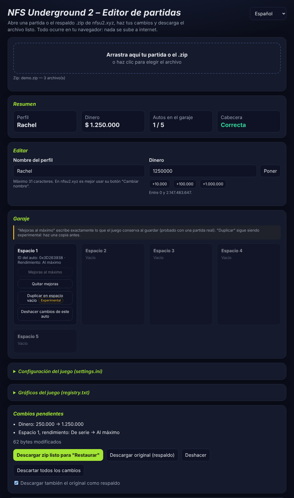

# NFSU2 Profile Editor

[](https://github.com/xGorgory/NFSU2-Profile-Editor/actions/workflows/tests.yml)
[](LICENSE)


Editor de partidas de **Need for Speed Underground 2** que funciona 100 % en el navegador: no hay servidor y tus partidas no se suben a ningún lado.
Compatible con las partidas del juego de PC y con el respaldo `.zip` de **[nfsu2.xyz](https://nfsu2.xyz) (Underground 2 Revived)**.

Disponible en español, inglés y portugués.

> *English summary below.*



## Cómo usarlo

1. Descarga el repositorio (botón **Code › Download ZIP**) y descomprímelo.
2. Abre `index.html` con doble clic en Chrome, Edge o Firefox.
3. Arrastra tu partida o el `.zip` de respaldo.
4. Cambia lo que quieras y pulsa **Descargar**.

### Con nfsu2.xyz

1. En nfsu2.xyz pulsa **Descargar copia de seguridad**.
2. Desactiva **Sincronizar** en la nube mientras pruebas.
3. Arrastra ese `.zip` al editor, haz los cambios y descarga el zip nuevo.
4. En nfsu2.xyz pulsa **Restaurar** y elige el zip nuevo. Si algo falla, restaura el original.

## Funciones

**Partida**
- Nombre del perfil (admite tildes y ñ, máximo 31 caracteres).
- Dinero con validación (0 a 2.147.483.647) y botones rápidos.
- Garaje: ver los 5 espacios y cuáles están bloqueados, **desbloquear espacios**, poner las mejoras al máximo (igual que las deja el juego) o quitarlas, duplicar un auto (experimental) y deshacer por espacio.
- Lista de cambios antes de descargar, deshacer (hasta 50 pasos) y descartar todo.
- Respaldo automático del original al descargar.

**Respaldo de nfsu2.xyz**
- Abre el `.zip` directamente y devuelve uno listo para **Restaurar**, con los mismos nombres de archivo.
- **Configuración del juego (`settings.ini`)**: 47 opciones con menús y buscador (idioma, resolución, FPS, mando, bocina, recorrido libre…). Conserva los comentarios del archivo.
- **Gráficos (`registry.txt`)**: reflejos, sombras, desenfoque, niebla, lluvia, nivel de detalle, etc.
- **Portadas de DVD y revista**: las que creaste en el juego se ven en el editor y se descargan como PNG.

**Investigación**
- **Comparador de partidas**: carga una copia de antes y una de después y muestra qué bytes cambiaron, con su valor como número y la zona conocida. Exporta a CSV.
- **Notas**: ponle nombre a cada zona que descubras; se guardan en el navegador y se exportan/importan en JSON.
- **Historial de respaldos** (hasta 40, en el navegador): abrir, descargar o comparar versiones anteriores con un clic.
- **Visor de bytes** con los cambios resaltados.

## Formato conocido

| Offset | Tamaño | Contenido |
|---|---|---|
| `0x0000` | 4 | Firma `20CM` |
| `0x0004` | 4 | Tamaño total del archivo |
| `0x000C` | 4 | Tamaño − 0x24 |
| `0x0010` | 16 | Suma de verificación (el juego la recalcula al guardar) |
| `0x5AEC` | 5 × `0x7F2` | Espacios del garaje: 16 bytes de ID del auto; rendimiento en +0x94 (0x44 bytes); bloqueo en +0x1AC (1 = bloqueado, 0 = disponible) |
| `0xA16A` | 4 | Dinero (int32, little-endian) |
| `0xD225` | 32 | Nombre del perfil (Windows-1252, terminado en 0) |

**Portadas (`<perfil> DVD n`):** misma firma `20CM`, cabecera de 0x24 bytes y luego una imagen de 512 × 512 en BGRA (1 MB). No son perfiles.

**Mejoras al máximo:** el juego conserva en 1 los bytes 0–56, 59 y 62 del bloque de rendimiento y pone el resto en 0.

**Comprobado:** nfsu2.xyz acepta partidas editadas aunque la suma de verificación no se recalcule; el juego la corrige la próxima vez que guarda.

### Pendiente

- Tabla de IDs de autos → nombres.
- Estadísticas de carrera, reputación y apariencia del auto.

¿Descubriste algo con el comparador? Mira [cómo contribuir](CONTRIBUTING.md) y abre un *issue* con la plantilla **Descubrimiento del formato**.

## Desarrollo

No necesita compilación ni dependencias.

```
src/core.js       lectura/escritura de la partida y del zip (también corre en Node)
src/settings.js   settings.ini y registry.txt
src/history.js    historial de respaldos (IndexedDB)
src/i18n.js       traducciones (para agregar un idioma, copia el bloque "es")
src/app.js        interfaz
tests/            pruebas
```

Pruebas (Node 18 o superior):

```
npm test
```

Usan una partida sintética, así que no hace falta ningún archivo personal. Para probar con una partida real, pásala como argumento (`node tests/core.test.js ruta/a/partida`) o déjala en `tests/fixtures/`, que está en `.gitignore`.

**No subas partidas ni respaldos al repositorio.** El `.gitignore` ya excluye `*.zip`, `*.sav`, `*.bak` y `tests/fixtures/`.

## Créditos

Basado en *NFSU2-Savegame-Editor* de **Christopher Hack** (MIT), que identificó las primeras posiciones del formato (dinero, nombre y garaje).

Proyecto de fans, sin relación con Electronic Arts. Haz siempre una copia de tus partidas antes de editarlas.

Licencia: [MIT](LICENSE).

---

## English summary

A browser-only save editor for **Need for Speed Underground 2**, compatible with PC saves and **nfsu2.xyz** backup zips. Open `index.html`, drop a save or backup zip, edit money, profile name, car performance, game settings (`settings.ini`) and graphics (`registry.txt`), then download a zip ready to restore. It also includes a byte-level save comparator with notes, a backup history and a hex viewer. Nothing is uploaded. Run `npm test` to run the tests (no dependencies). Based on Christopher Hack's NFSU2-Savegame-Editor (MIT).
